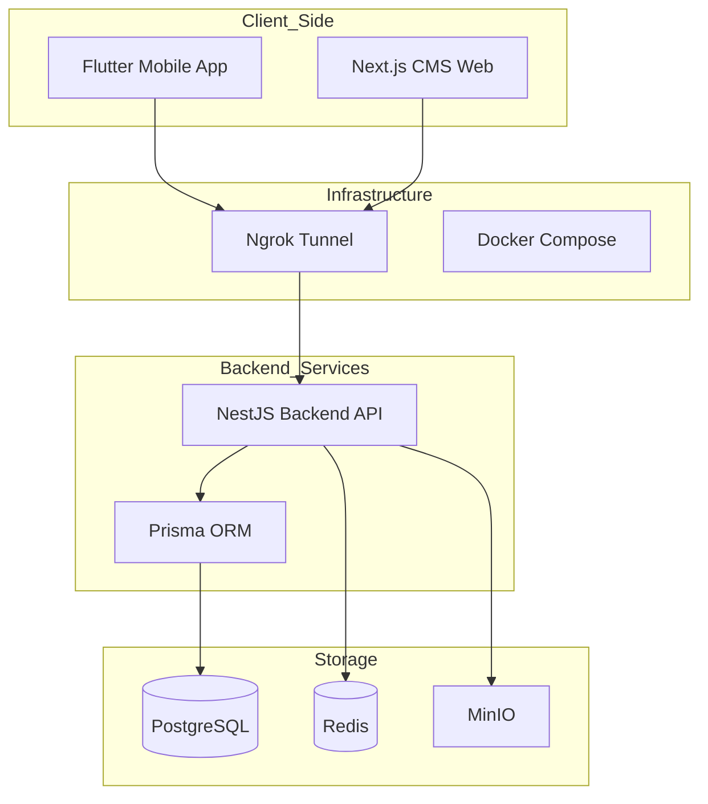

# SYSTEM ARCHITECTURE

## 1. High-Level Architecture
Hệ thống được thiết kế theo mô hình Microservices-ready Monolith với khả năng scale-out.

## 2. Key Components

### 2.1. Backend (NestJS)
- **Kiến trúc:** Modular architecture.
- **Security:** JWT (Access + Refresh Token), RBAC.
- **Multi-tenancy:** Dữ liệu được phân tách bằng `store_id` (Tenant ID) trong mỗi bảng.

### 2.2. CMS Web (Next.js)
- **Pattern:** Component-based architecture.
- **State Management:** TanStack Query cho server state.

### 2.3. Mobile App (Flutter)
- **Kiến trúc:** Clean Architecture (Data, Domain, Presentation).
- **State Management:** Riverpod.

## 3. Deployment Strategy
- Toàn bộ backend và services chạy trong Docker.
- Ngrok được sử dụng để expose API ra internet cho Flutter App và CMS.
